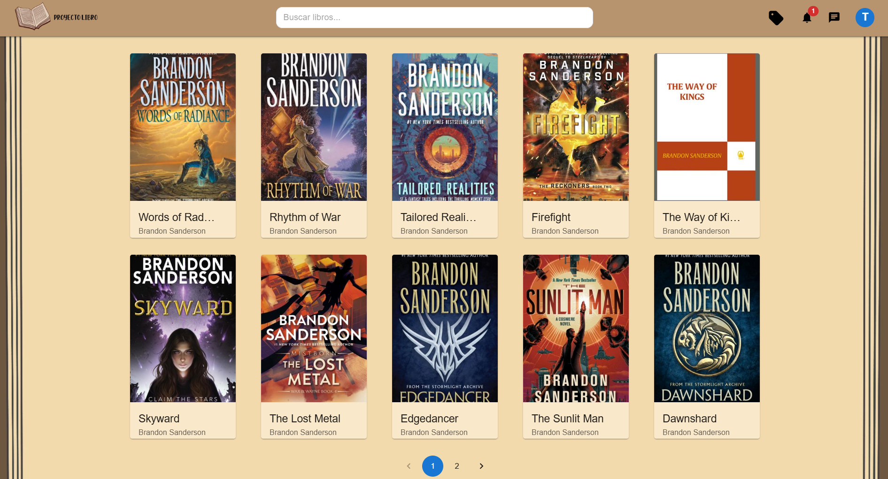
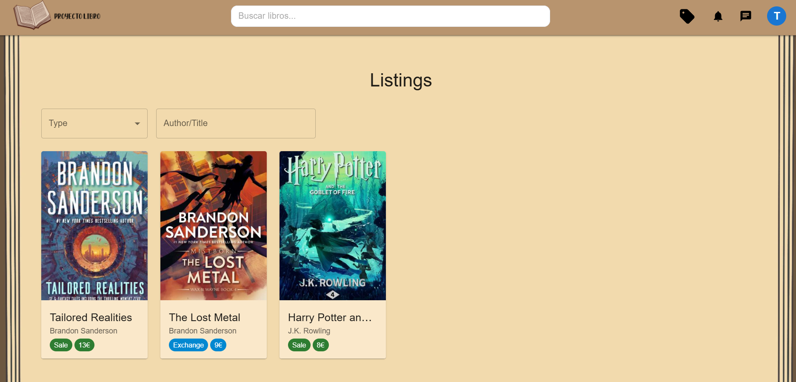
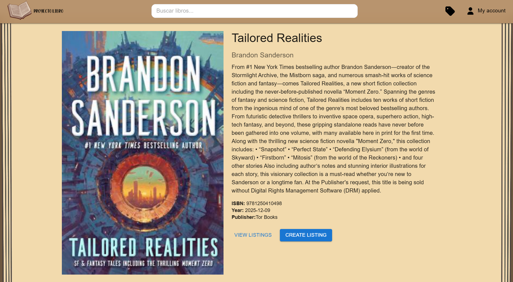
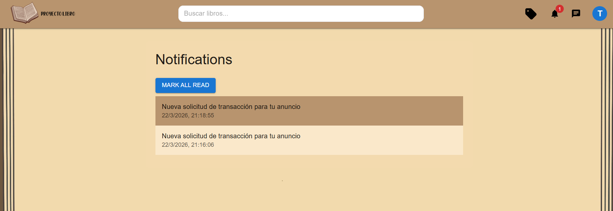
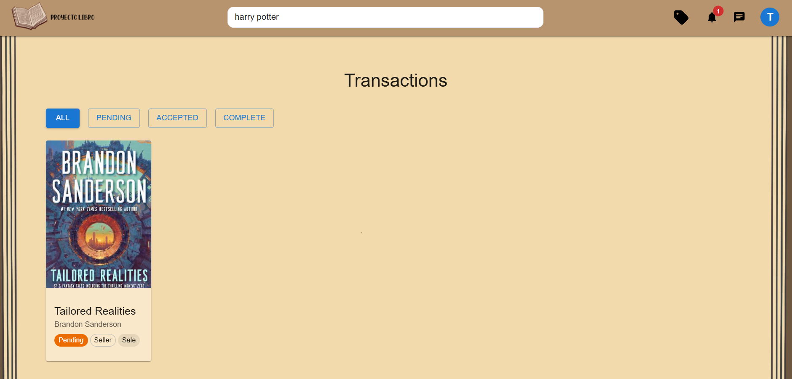
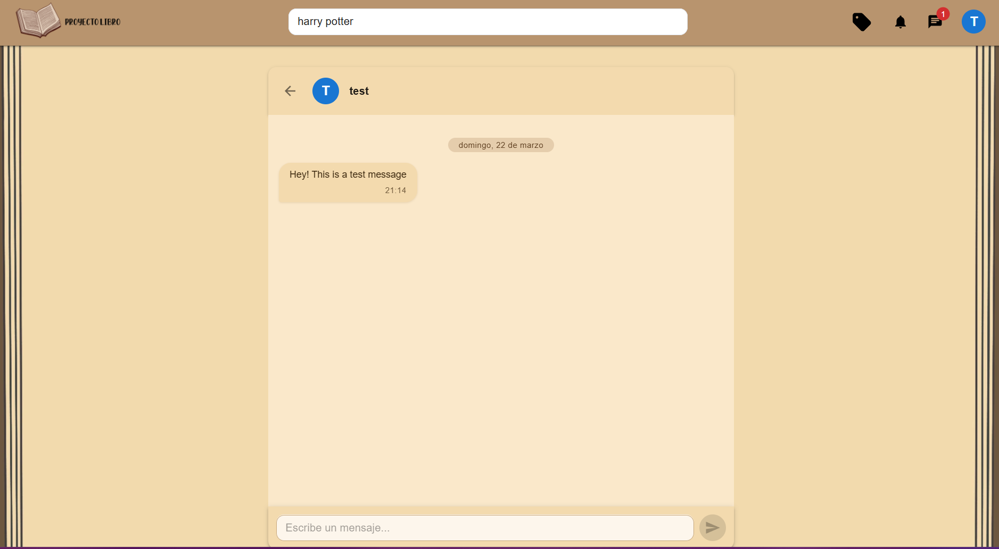
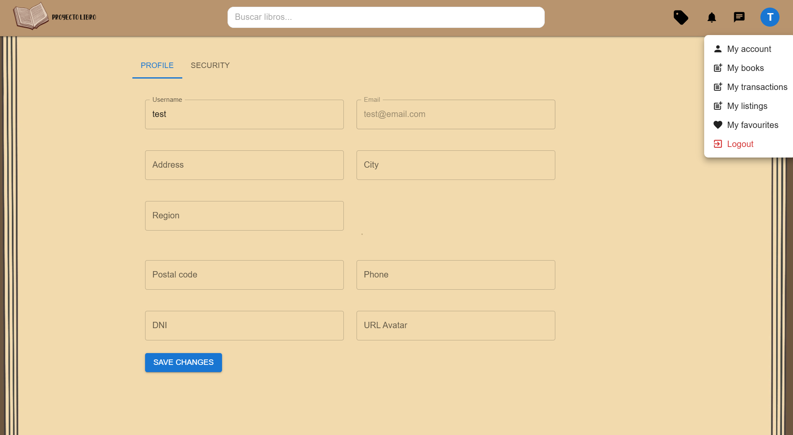

# BookSwap — Plataforma de intercambio de libros

**Español** · [English](README_EN.md)


**[Demo](https://proyecto-libro-frontend.onrender.com)** · **[API](https://proyecto-libro-backend.onrender.com/health)**

> El backend está en el plan gratuito de Render y puede tardar unos 30 segundos en arrancar la primera vez.

Aplicación web full stack para comprar, vender e intercambiar libros de segunda mano entre usuarios. Desarrollada con React, Node.js/Express, PostgreSQL y Docker.

## Capturas

| Inicio | Anuncios | Detalle del libro | Notificaciones |
|------|----------|-------------|---------------|
|  |  |  |  |

| Transacciones | Mensajes | Mi cuenta |
|--------------|----------|------------|
|  |  |  |

## Qué incluye

- **API REST de 38 endpoints** con arquitectura por capas (rutas → middlewares → controladores → repositorios) y **13 modelos** en PostgreSQL con Prisma.
- **Compraventa e intercambio** con ciclo completo de transacción (`pendiente → aceptada/rechazada → completada/cancelada`) y confirmación de ambas partes.
- **Mensajería entre usuarios** con el contenido **cifrado con AES-256-CBC**.
- **Autenticación JWT**, contraseñas con **bcrypt**, validación en servidor y rutas protegidas en frontend y backend.
- Notificaciones, favoritos y búsqueda de libros con la **API de Google Books**.
- **31 tests** (Vitest y Supertest) ejecutados en cada push con **GitHub Actions**.
- Despliegue con **Docker Compose** y **Nginx**.

## Stack

**Frontend:** React 19, Vite, React Router, Material UI, Axios
**Backend:** Node.js, Express 5, Prisma 6, PostgreSQL 16, JWT, bcrypt
**Testing y CI:** Vitest, Supertest, React Testing Library, GitHub Actions
**Infraestructura:** Docker, Docker Compose, Nginx, Render

## Arquitectura

```
Frontend (React + Nginx) ──▶ Backend (Express) ──▶ PostgreSQL (Prisma)
                                   │
                                   ▼
                           Google Books API
```

## Ejecutar en local

```bash
git clone https://github.com/EntyumDAW/proyecto-libro
cd proyecto-libro
# Configura las variables de entorno (ver backend/.env.example)
docker compose up --build
```

La app queda en `http://localhost:5173` y la API en `http://localhost:4000`.

## Tests

```bash
cd backend && npm test    # 17 tests: health, auth, búsqueda y detalle de libros
cd frontend && npm test   # 14 tests: gestión de errores y traducciones
```

Los repositorios y las APIs externas están mockeados, así que no hace falta base de datos ni conexión a internet.

## Licencia

Copyright (c) 2025 Antonio Armero Muñoz. Todos los derechos reservados. El código es público solo con fines de portfolio y educativos.
