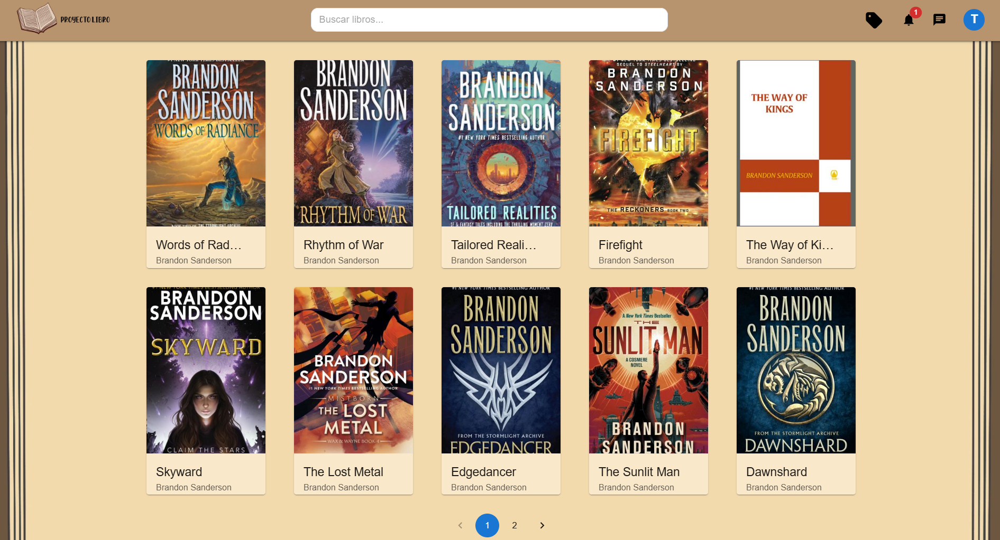
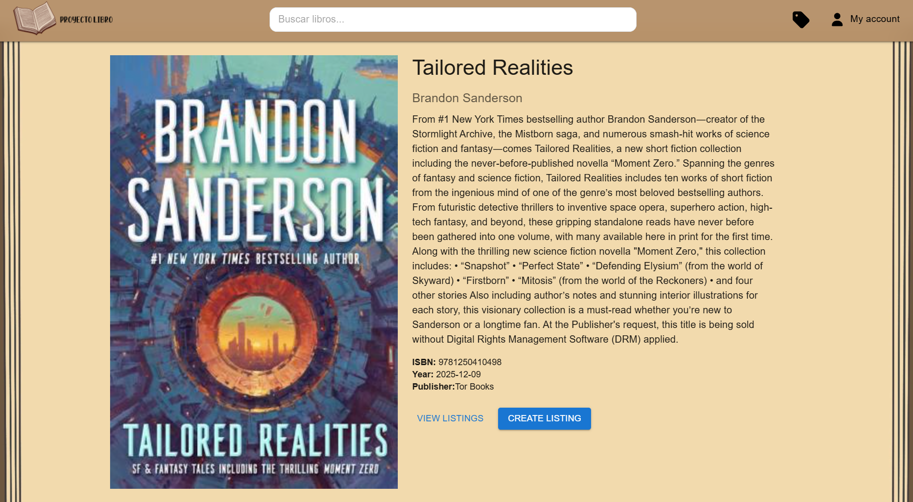
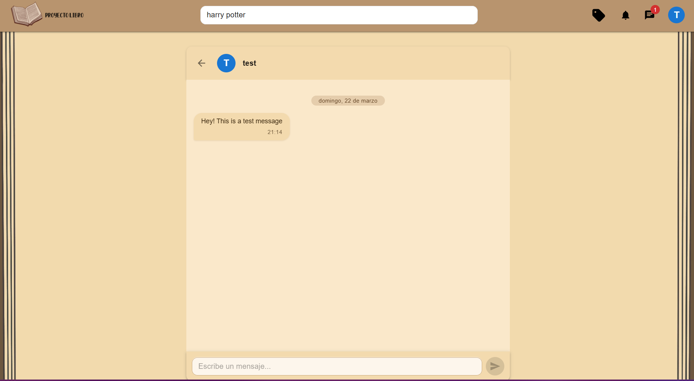
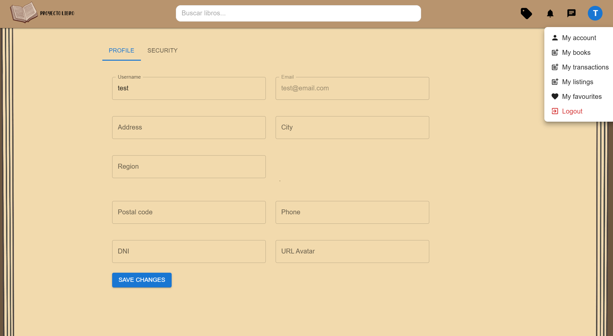

# BookSwap — Book Exchange Platform

[Español](README.md) · **English**


**[Live Demo](https://proyecto-libro-frontend.onrender.com)** · **[API](https://proyecto-libro-backend.onrender.com/health)**

> The backend runs on Render's free tier and may take around 30 seconds to wake up on the first request.

Full stack web application for buying, selling and exchanging second-hand books between users. Built with React, Node.js/Express, PostgreSQL and Docker.

## Screenshots

| Home | Listings | Book Detail | Notifications |
|------|----------|-------------|---------------|
|  |  |  |  |

| Transactions | Messages | My Account |
|--------------|----------|------------|
|  |  |  |

## Highlights

- **38-endpoint REST API** with a layered architecture (routes → middlewares → controllers → repositories) and **13 PostgreSQL models** with Prisma.
- **Buying, selling and exchanging** with a full transaction lifecycle (`pending → accepted/rejected → completed/cancelled`) and two-party confirmation.
- **User messaging** with message content **encrypted with AES-256-CBC**.
- **JWT authentication**, **bcrypt** password hashing, server-side validation and protected routes on both frontend and backend.
- Notifications, favourites and book search via the **Google Books API**.
- **31 tests** (Vitest and Supertest) running on every push with **GitHub Actions**.
- Deployment with **Docker Compose** and **Nginx**.

## Tech Stack

**Frontend:** React 19, Vite, React Router, Material UI, Axios
**Backend:** Node.js, Express 5, Prisma 6, PostgreSQL 16, JWT, bcrypt
**Testing & CI:** Vitest, Supertest, React Testing Library, GitHub Actions
**Infrastructure:** Docker, Docker Compose, Nginx, Render

## Architecture

```
Frontend (React + Nginx) ──▶ Backend (Express) ──▶ PostgreSQL (Prisma)
                                   │
                                   ▼
                           Google Books API
```

<details>
<summary><b>API endpoints</b></summary>

All endpoints are prefixed with `/api`, except `/health`.

| Method | Endpoint | Auth | Description |
|--------|----------|------|-------------|
| `POST` | `/auth/register` | — | Register a new user |
| `POST` | `/auth/login` | — | Log in and receive a JWT |
| `GET` | `/libros/search?q=` | — | Search books via Google Books |
| `GET` | `/libros/:id` | — | Book detail by ISBN or Google ID |
| `POST` | `/libros/nuevo-libro` | ✓ | Create a book manually |
| `GET` | `/categorias` | — | List categories |
| `POST` | `/categorias/nueva` | ✓ | Create a category |
| `GET` | `/ejemplares/mis-ejemplares` | ✓ | The user's book copies |
| `GET` | `/ejemplares/:libro_id` | — | Copies of a book |
| `POST` | `/ejemplares/crear-ejemplar` | ✓ | Add a book copy |
| `PUT` | `/ejemplares/actualizar-ejemplar/:id` | ✓ | Update a book copy |
| `DELETE` | `/ejemplares/borrar-ejemplar/:id` | ✓ | Delete a book copy |
| `GET` | `/anuncios` | — | Browse active listings |
| `GET` | `/anuncios/mis-anuncios` | ✓ | The user's listings |
| `GET` | `/anuncios/:id` | — | Listing detail |
| `POST` | `/anuncios/crear-anuncio` | ✓ | Create a listing |
| `PUT` | `/anuncios/actualizar-anuncio/:id` | ✓ | Update a listing |
| `DELETE` | `/anuncios/borrar-anuncio/:id` | ✓ | Delete a listing |
| `POST` | `/transacciones` | ✓ | Start a transaction |
| `GET` | `/transacciones/mis-transacciones` | ✓ | The user's transactions |
| `PUT` | `/transacciones/:id/aceptar` | ✓ | Accept a transaction |
| `PUT` | `/transacciones/:id/cancelar` | ✓ | Cancel a transaction |
| `PUT` | `/transacciones/:id/completar` | ✓ | Confirm a transaction as completed |
| `GET` | `/notificaciones` | ✓ | User notifications |
| `GET` | `/notificaciones/no-leidas` | ✓ | Unread notification count |
| `PUT` | `/notificaciones/:id/leida` | ✓ | Mark one as read |
| `PUT` | `/notificaciones/todas-leidas` | ✓ | Mark all as read |
| `GET` | `/perfil` | ✓ | Get profile |
| `PUT` | `/perfil/actualizar-perfil` | ✓ | Update profile |
| `PUT` | `/perfil/cambiar-password` | ✓ | Change password |
| `GET` | `/favoritos` | ✓ | List favourites |
| `POST` | `/favoritos/toggle` | ✓ | Add or remove a favourite |
| `GET` | `/favoritos/:libroRef` | ✓ | Check if a book is a favourite |
| `GET` | `/mensajes/no-leidos` | ✓ | Unread message count |
| `GET` | `/mensajes/conversaciones` | ✓ | List conversations |
| `POST` | `/mensajes/conversaciones` | ✓ | Start a conversation |
| `GET` | `/mensajes/conversaciones/:id` | ✓ | Messages in a conversation |
| `POST` | `/mensajes/conversaciones/:id/mensajes` | ✓ | Send a message |
| `GET` | `/health` | — | Server and database health check |

</details>

<details>
<summary><b>Data model</b></summary>

| Model | Description |
|-------|-------------|
| `usuario` | User accounts with profile and role (user/admin) |
| `libros` | Book metadata (ISBN, title, author, synopsis, cover) |
| `ejemplares` | Physical copies owned by users |
| `anuncio` | Sale or exchange listings for a copy |
| `intercambio_deseado` | Books accepted in exchange for a listing |
| `transacciones` | Transaction between two users |
| `transporte` | Shipping details for a transaction |
| `conversacion` | 1-to-1 conversation (unique per user pair) |
| `mensaje` | Encrypted message in a conversation |
| `notificaciones` | Notifications per user |
| `favorito` | Saved books per user |
| `categorias` | Hierarchical categories |
| `libro_categoria` | Book–category relation |

</details>

## Run locally

```bash
git clone https://github.com/EntyumDAW/proyecto-libro
cd proyecto-libro
# Set up the environment variables (see backend/.env.example)
docker compose up --build
```

The app runs at `http://localhost:5173` and the API at `http://localhost:4000`.

## Testing

```bash
cd backend && npm test    # 17 tests: health, auth, book search and detail
cd frontend && npm test   # 14 tests: error handling and translations
```

Repositories and external APIs are mocked, so no database or network connection is needed.

## License

Copyright (c) 2025 Antonio Armero Muñoz. All rights reserved. The source code is publicly visible for portfolio and educational purposes only.
