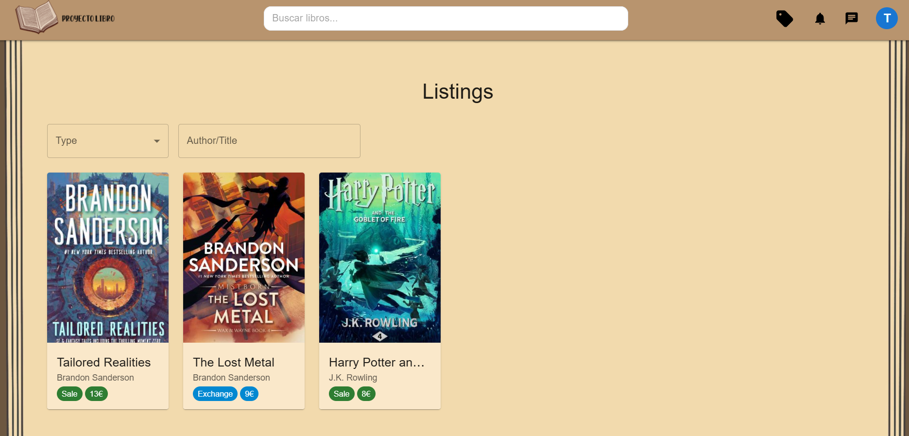
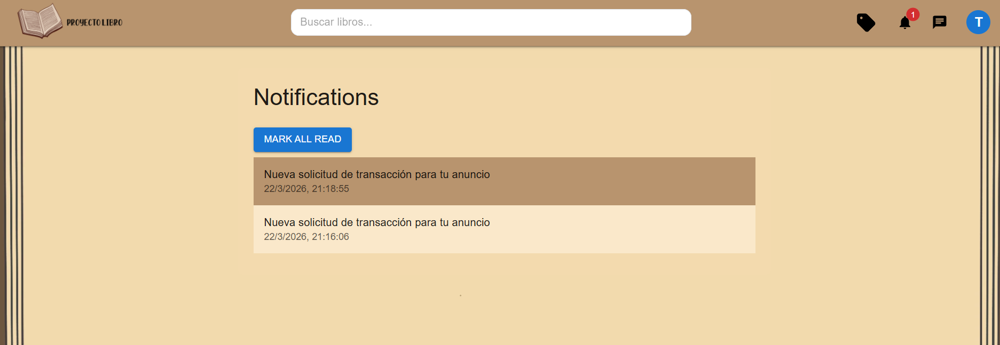
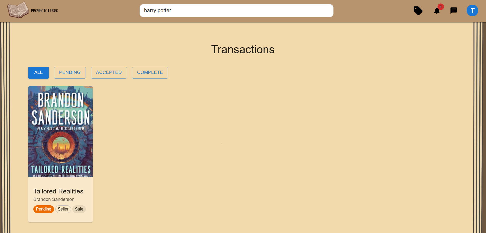

# BookSwap — Book Exchange Platform

[Español](README.md) · **English**


**[Live Demo](https://proyecto-libro-frontend.onrender.com)** · **[API](https://proyecto-libro-backend.onrender.com/health)**

> The backend runs on Render's free tier and may take around 30 seconds to wake up on the first request.

Full stack web application for buying, selling and exchanging second-hand books between users. Built with React, Node.js/Express, PostgreSQL and Docker.

## Screenshots

| Home | Listings | Book Detail | Notifications |
|------|----------|-------------|---------------|
|  |  |  |  |

| Transactions | Messages | My Account |
|--------------|----------|------------|
|  |  |  |

## Highlights

- **38-endpoint REST API** with a layered architecture (routes → middlewares → controllers → repositories) and **13 PostgreSQL models** with Prisma.
- **Buying, selling and exchanging** with a full transaction lifecycle (`pending → accepted/rejected → completed/cancelled`) and two-party confirmation.
- **User messaging** with message content **encrypted with AES-256-CBC**.
- **JWT authentication**, **bcrypt** password hashing, server-side validation and protected routes on both frontend and backend.
- Notifications, favourites and book search via the **Google Books API**.
- **31 tests** (Vitest and Supertest) running on every push with **GitHub Actions**.
- Deployment with **Docker Compose** and **Nginx**.

## Tech Stack

**Frontend:** React 19, Vite, React Router, Material UI, Axios
**Backend:** Node.js, Express 5, Prisma 6, PostgreSQL 16, JWT, bcrypt
**Testing & CI:** Vitest, Supertest, React Testing Library, GitHub Actions
**Infrastructure:** Docker, Docker Compose, Nginx, Render

## Architecture

```
Frontend (React + Nginx) ──▶ Backend (Express) ──▶ PostgreSQL (Prisma)
                                   │
                                   ▼
                           Google Books API
```

## Run locally

```bash
git clone https://github.com/EntyumDAW/proyecto-libro
cd proyecto-libro
# Set up the environment variables (see backend/.env.example)
docker compose up --build
```

The app runs at `http://localhost:5173` and the API at `http://localhost:4000`.

## Testing

```bash
cd backend && npm test    # 17 tests: health, auth, book search and detail
cd frontend && npm test   # 14 tests: error handling and translations
```

Repositories and external APIs are mocked, so no database or network connection is needed.

## License

Copyright (c) 2025 Antonio Armero Muñoz. All rights reserved. The source code is publicly visible for portfolio and educational purposes only.
